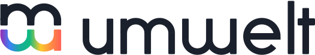

<p align="center">
  <picture>
    <source media="(prefers-color-scheme: dark)" srcset="assets/brand/umwelt-lockup-on-dark.svg" />
    
  </picture>
</p>

<p align="center">
  <strong>What happened, and who knows it.</strong><br />
  An epistemic state engine that tracks what each character knows, and how they learned it.
</p>

<p align="center">
  <a href="docs/getting-started.md">Getting started</a> ·
  <a href="docs/concepts.md">Concepts</a> ·
  <a href="docs/use-cases.md">Use cases</a> ·
  <a href="spec/README.md">Specification</a> ·
  <a href="https://discord.com/invite/CE4C9JRS9H">Discord</a>
</p>

---

Umwelt records what happened in a world and, kept apart from it, what each
character knows, believes, suspects or remembers about it: from whom they
learned it, at which point of the story, and whether it is still true. Every
question is answered from a position and for a perspective, so "what did Ana
know in chapter 6" is a query, not an act of memory.

It works entirely without AI, and it is built to keep AI characters honest:
a model voicing Ana is given what Ana knows, never the twist she has not
learned yet.

> **Status:** `0.1`, the first public release. The engine is complete and
> tested. The API may still change before `1.0`; every change to the file
> format comes with an automatic migration, so your files keep opening (see
> [versioning](spec/versioning.md)).

## What makes it different

- **A fact is not knowledge of it.** Canon about a character is not known by
  that character, or by anyone, until a record says so.
- **Being in the room grants nothing.** Who witnessed a scene, and how clearly,
  is recorded per character.
- **Beliefs may be wrong, and stay held.** A belief that contradicts canon is
  kept and reported, never silently corrected.
- **Every piece of knowledge has a source.** Who told whom, honestly or not,
  can be traced back link by link.
- **History is never rewritten.** Forgetting, revising and retracting are new
  records; every earlier state stays readable.
- **Groups know their own things.** What a guild knows is not the union of what
  its members know.
- **Feelings are directional.** What Ana feels toward Bob says nothing about
  what Bob feels toward Ana.
- **Secrets are recorded, not enforced.** Telling one to the wrong person is
  allowed, warned about and reported.
- **Time can run on more than one clock.** Story order and reading order live
  side by side: a flashback happens early and is read late.
- **Work can wait for approval.** A day of play or a generated scene waits in a
  draft timeline until it is promoted or discarded.
- **Search stays inside the perspective.** Full-text and semantic search,
  with vectors from your own embedding model, never surface what the reader
  may not know.
- **Nothing is dropped silently.** Every refusal, such as a memory left out of
  a model's context, comes with a reason.

## Quick start

| | Install | Guide |
| --- | --- | --- |
| Command line | `cargo install --git https://github.com/Kallamo/Umwelt umwelt-cli`, or a [release](https://github.com/Kallamo/Umwelt/releases) | [getting-started](docs/getting-started.md#command-line) |
| TypeScript / Node.js | `npm install @kallamo/umwelt` | [getting-started](docs/getting-started.md#typescript), [client guide](packages/umwelt/README.md) |
| .NET 6+ | `dotnet add package Kallamo.Umwelt` | [getting-started](docs/getting-started.md#net), [binding guide](bindings/csharp/Kallamo.Umwelt/README.md) |
| Any language | `umwelt serve world.umw`, JSON over stdio, or the C ABI | [protocol](spec/protocol.md) |

```ts
import { createClient } from '@kallamo/umwelt';

const client = createClient({ file: 'story.umw', create: true });
// ... record a scene in which Ana sees Bob steal the necklace ...
const { holds } = await client.holds({ projectId: 'ball', holder: 'duchess', claim: theft });
// holds === false: the duchess was at the ball, but nothing says she saw it
```

The full scene is in [getting started](docs/getting-started.md).

## How it works

```text
CLI ──────────────┐
@kallamo/umwelt ──┤  JSON protocol v1
Kallamo.Umwelt ───┤  (stdio or C ABI)  ──>  engine (Rust)  ──>  world.umw (SQLite)
any language ─────┘
```

A world lives in one portable `.umw` file, which can hold several isolated
projects. The engine is written in Rust and runs as a command-line server or
inside your process; every client speaks the same JSON protocol, described by
JSON Schemas, and passes the same conformance cases.

Umwelt never runs or calls a model and never applies policy: how fast
memories fade, whom a character trusts and which vectors to search with are
the application's decisions. The engine records them and reports what
follows. The guarantees it keeps are listed in
[spec/invariants.md](spec/invariants.md).

## Documentation

- [Getting started](docs/getting-started.md): the first scene, in each client.
- [Concepts](docs/concepts.md): the vocabulary.
- [Use cases](docs/use-cases.md): tabletop campaigns, novels, games and AI
  contexts.
- [Architecture](docs/architecture.md): how the engine is built.
- [Specification](spec/README.md): every operation and rule.
- [Benchmarks](benchmarks/README.md): measured performance.

## Contributing

Issues, ideas and pull requests are welcome; read
[CONTRIBUTING.md](CONTRIBUTING.md) first. Report security issues privately as
described in [SECURITY.md](SECURITY.md). Talk to us on
[Discord](https://discord.com/invite/CE4C9JRS9H).

Umwelt is built by [Kallamo](https://kallamo.com).

## License

Copyright (C) 2026 Jonathan Ferreira da Conceição.

Umwelt is licensed under the GNU Affero General Public License, version 3 only
(AGPL-3.0-only). The full text is in [`LICENSE`](LICENSE) and the copyright
notice in [`NOTICE`](NOTICE).

- **Free games, mods, interactive fiction and tabletop play tools** that make
  no money (no price, purchases, ads or paid content) may use Umwelt without
  releasing their own code, as long as they credit it: see the
  [Umwelt Free Play Exception](LICENSE-EXCEPTION.md).
- **Private or internal use**, and **projects released under the AGPL**, need
  nothing more.
- **Everything else** that cannot comply with the AGPL, such as commercial
  products and hosted services, can obtain a commercial license:
  contact@kallamo.com.

"Umwelt" and "Kallamo" are trademarks of their creator: a fork or
redistribution must use its own name.
